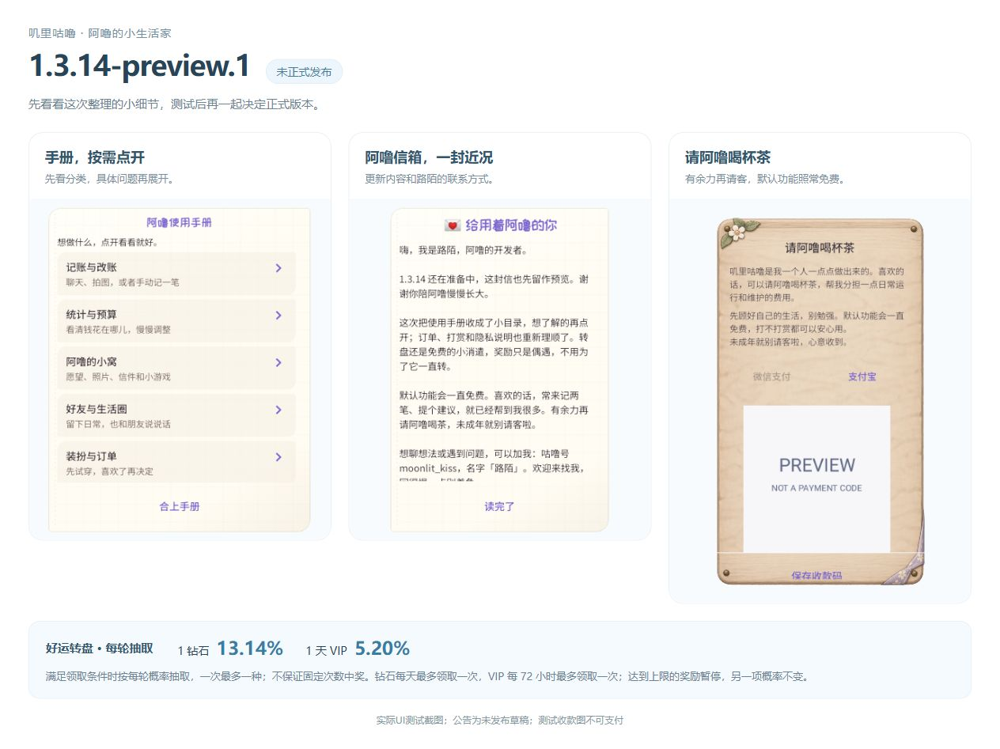

# 叽里咕噜 · 阿噜的小生活家

聊天记一笔账，收好一张照片，再去阿噜的小窝坐坐。

**1.3.14** · Android 8.0 及以上

[下载 Android 安装包](https://github.com/Xiamol/jiligulu/releases/download/v1.3.14/jiligulu-1.3.14-release.apk) · [更新说明与可选组件](https://github.com/Xiamol/jiligulu/releases/tag/v1.3.14)

已有版本直接覆盖安装，保留本机数据。

界面示意取自发布前预览，收款图为不可支付的测试图片。

## 可以做些什么

- **记账与统计**：手动输入、对话记账、图片识别；草稿确认后入账。分类、预算、收支图表和小计算器，够日常使用。
- **收好生活**：给账单夹照片，制作明信片，收藏小纸条，写下愿望，寄一封给未来的信。
- **阿噜的小窝**：不同主题、白天与夜晚，还有象棋、五子棋、转盘等小玩法。
- **和朋友来往**：个人主页、好友聊天、生活圈、棋局邀请。装扮可以先试穿，再决定是否使用。

基础功能可以一直免费使用。装扮、会员及自愿支持各有说明，不打赏也照常使用默认功能。未成年人请不要打赏。

## 安装前知道这些

已有版本请覆盖安装，先别卸载或清数据；本机账单、照片和聊天不会因账号找回而自动恢复到另一台手机。

基本记账和部分本地玩法可离线使用。象棋已内置，无需另装；五子棋采用按需组件，首次下载后可离线玩，卸载组件会保留棋局存档。AI、好友、生活圈及权益操作需要网络和可用的服务。付款目前由开发者人工核对，请按应用提示备注咕噜号；付过款但没有备注，可以在订单里反馈。

[简明使用手册](docs/HANDBOOK.md) · [本次更新](docs/RELEASE_1_3_14.md) · [隐私与使用说明](docs/AGREEMENTS.md)

## 它是怎样运行的

手机端使用 Kotlin、Jetpack Compose 和 Room，账本、照片及本地记忆主要保存在手机上。在线功能由开发者的电脑运行 Node.js 服务，通过 Sakura 隧道连接互联网；默认 AI 请求由电脑转发，也支持用户自行配置兼容服务。

这是个人维护的应用，电脑休眠、断网或隧道维护时，部分在线功能会暂时不可用。它目前没有整库自动云同步；账号找回与本机资料备份是两件事。

调用 AI 会发送本次问题及所需的文字、图片或账本上下文；发布生活圈或发送好友消息，也会把对应内容发送给在线服务。具体范围见应用内说明。

## 找到开发者

我是 **路陌**，在应用里搜索咕噜号 **`moonlit_kiss`** 就能找到我。欢迎加好友，聊聊使用感受，或告诉我哪里还不顺手。反馈问题时记得遮住账单、照片和付款信息。

## 关于这个仓库

本次更新仅包含产品说明、经过检查的演示图，以及第三方组件要求提供的许可与对应源码；当前应用主体和服务端的新实现不在本次公开范围内。仓库中已经公开的历史版本仍保留其历史状态，不能据此认为本次应用已全部开源。

第三方代码、字体和图像分别遵循原许可，见 [第三方说明](THIRD_PARTY.md)。本仓库没有为整款应用授予统一的 MIT 或其他开源许可。
